# Pawse user guide

How to install Pawse, lock and unlock the keyboard, and set up every page of Settings, with
updates, files and troubleshooting.

Audience: anyone running Pawse on Windows.

[README](../README.md) (overview, downloads, privacy, building) · [Screenshot gallery](screenshots/README.md) · [Installer details](../packaging/README.md)

**Contents:** [Installing Pawse](#installing-pawse) · [Starting and quitting Pawse](#starting-and-quitting-pawse) · [The tray icon and its menu](#the-tray-icon-and-its-menu) · [Locking the keyboard](#locking-the-keyboard) · [Unlocking the keyboard](#unlocking-the-keyboard) · [The lock popup](#the-lock-popup) · [Changing settings](#changing-settings) · [Updating Pawse](#updating-pawse) · [Where settings and the log live](#where-settings-and-the-log-live) · [Uninstalling Pawse](#uninstalling-pawse) · [Troubleshooting](#troubleshooting)

## Installing Pawse

Which file to download, and what each build needs, is in the README:
[Install](../README.md#install). If you're not sure, take `Pawse-Setup-<version>-full.exe`.

**With the installer:**

1. Run the `Pawse-Setup-<version>…exe` you downloaded. Opening it never asks for administrator
   rights.
2. On **Choose Users**, pick who gets Pawse:
   - **Install just for me** (the default) installs into your own profile and needs no
     administrator rights.
   - **Install for anyone using this computer** installs into Program Files. Windows asks for
     administrator rights once you click on; if you decline, Pawse is installed for you only and
     the installer says so.
3. Only `Pawse-Setup-<version>.exe` (the one without `-full` or `-min`) asks which build to
   install next: **Full** (runtime bundled) or **Minimal** (needs the .NET 10 Desktop Runtime,
   which the installer offers to fetch with winget).
4. Choose the **Start Menu shortcut** and **Desktop shortcut** you want, and the folder.
5. Leave **Launch Pawse now** ticked on the last page to start it straight away.

If Pawse is running, the installer asks before closing it, and lets it shut down
properly so its Win+L and media-key blocks are undone.

**Portable:** unzip `Pawse-<version>.zip` (or the `-min` one) anywhere you can write to and run
the exe inside. A portable copy keeps everything in its own folder and writes nothing to the
registry, so three options need the installed version: starting with Windows, **Block Win+L**
and the media-key block. Settings shows them greyed out, with the reason beside them.

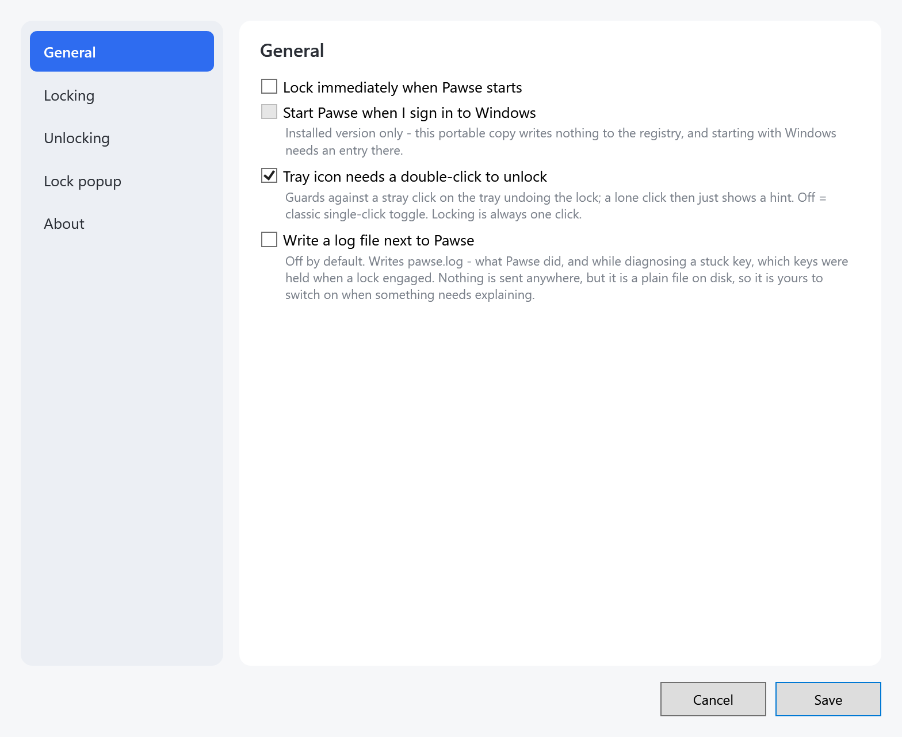

Windows may block a downloaded exe from starting. Right-click it (or the zip) →
**Properties** → **Unblock** first.

## Starting and quitting Pawse

- **Start** Pawse from the Start Menu or Desktop shortcut, or run `Pawse.exe`. A paw appears in
  the system tray; Pawse has no other window until you open one.
- **Start with Windows:** tick **Start Pawse when I sign in to Windows** in
  [Settings → General](#general) (installed copies only).
- **Quit:** right-click the paw → **Quit**. While the keyboard is locked, Pawse first asks
  **Pawse is locked. Quit Pawse and release the keyboard?**
- **Starting a second copy** (a portable build you just unzipped, say) doesn't simply refuse.
  It asks whether to close the Pawse that's already running and start this copy instead. If the
  running one has the keyboard locked, closing it hands the keyboard back. Answer **No** to
  leave the running copy alone.
  - If the running Pawse was restarted as administrator, the new copy can't ask it to close and
    tells you to quit it from the tray first.

## The tray icon and its menu

The paw in the system tray shows the lock state; hover over it to see **Pawse - unlocked** or
**Pawse - locked**.

- **Left-click** locks.
- While locked, **double-click** unlocks. A single click only shows the balloon
  **Locked - double-click the paw to unlock.**, so a stray click can't undo the lock. To make a
  single click unlock as well, untick **Tray icon needs a double-click to unlock** in
  [Settings → General](#general).
- **Right-click** opens the menu:

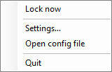

| Item | What it does |
| --- | --- |
| **Lock now** / **Unlock** | Locks, or unlocks while locked. The label follows the state. |
| **Settings…** | Opens the [Settings](#changing-settings) window, or brings it to the front. |
| **Open config file** | Opens `pawse.json` in the program Windows uses for `.json` files. See [Where settings and the log live](#where-settings-and-the-log-live). |
| **Restart as administrator** | Shown only when Pawse isn't already elevated. Starts Pawse again with administrator rights after the Windows prompt; needed for **Block Win+L** on managed PCs and for the media-key block. |
| **Quit** | Closes Pawse and undoes everything it blocked. Asks first while locked. |

On an account that isn't an administrator, **Restart as administrator** warns that Pawse would
run under the administrator account you sign in with: the media-key block works that way,
**Block Win+L** does not (it would apply to that account, not to yours).

## Locking the keyboard

Lock in any of these ways:

- Left-click the tray paw, or right-click it → **Lock now**.
- Press the **lock hotkey**, `Ctrl+L` by default. Change or switch it off in
  [Settings → Locking](#locking). The hotkey also works while you hold other keys; it does nothing
  while the Settings window is open (so recording a new one can't lock you out mid-capture), and
  works again once Settings is closed or minimized.
- Tick **Lock immediately when Pawse starts** in [Settings → General](#general).

While locked, Pawse swallows every key of the physical keyboard and shows the
[lock popup](#the-lock-popup). Locking also releases any modifier Windows thought was still held,
which fixes the "Ctrl seems stuck, the browser zooms when I scroll" problem. What else can be
blocked, and what can't, is in the README: [What it can and can't block](../README.md#what-it-can-and-cant-block).

## Unlocking the keyboard

Each method can be switched on or off on its own under [Settings → Unlocking](#unlocking);
the popup names every method that works with your current settings.

| Method | Default | How |
| --- | --- | --- |
| Keyboard chord | on, `Ctrl+L` | Press the chord. |
| Lockphrase | off (text `unlock`) | Type the phrase; nothing appears anywhere while you type. |
| Mouse hold | on, 1200 ms | Hold the popup's **Hold to unlock** button, or the paw, until it fills. |
| Auto timer | off, 300 s | Wait; Pawse unlocks by itself. |
| Tray paw | always | Double-click it (single-click when the double-click guard is off), or right-click → **Unlock**. |
| Settings window | always | Click **Unlock** in the yellow banner of an open Settings window. |
| Quit | always | Right-click the paw → **Quit** → **Yes**. |

Details worth knowing:

- **The chord must be held on its own.** Only the chord's keys may be down: a cat lying on
  `Ctrl`, `L` and ten other keys doesn't unlock. A key still held from locking (the `Ctrl+L` you
  locked with) counts only after you let go of it and press it again.
- **The lockphrase** ignores case and accepts letters, digits (top row or keypad) and Space.
  Other keys don't count. With **A wrong key restarts the lockphrase** on (the default), a wrong
  letter or digit sends you back; with it off, wrong keys are ignored and your progress is kept.
- **Mouse hold** needs the lock popup shown and the mouse not blocked. Let go early, or move off it, and
  the fill resets.
- **The auto timer** starts when you lock. Saving Settings while locked restarts it from the full
  new duration.
- **On-screen keyboards** still type while locked unless you block them
  ([Settings → Locking](#locking)), so tapping the chord or the lockphrase on one unlocks too.

**You can't lock yourself out.** If you save settings with no working unlock method (every method
off, a lockphrase that can't be typed, or mouse hold with the mouse blocked or the popup off),
Pawse turns the keyboard chord back on, sets it to `Ctrl+L` if it had no usable keys, and tells
you. The same check runs when Pawse starts.

## The lock popup

While locked, a small popup floats on the displays you chose; the rest of the desktop stays
visible. It comes in two styles, picked in [Settings → Lock popup](#lock-popup):

**Window** - the title **Keyboard locked**, a line naming each way to unlock, and the
**Hold to unlock** button, whose bar fills from left to right as you hold it.

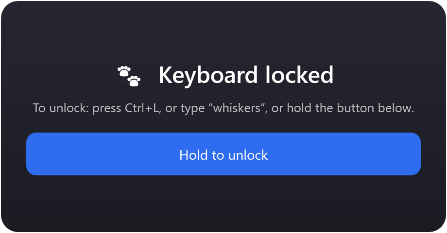

**Paw icon** - the tray paw at the size you set, with an optional hint box beneath. Hold the paw
to unlock; it fills green from the bottom.

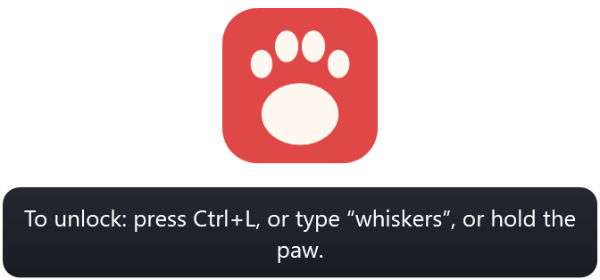

What the hint line says:

- It lists only methods that work right now, for example
  **To unlock: press Ctrl+L, or type “whiskers”, or hold the button below.**
- With **Show the lockphrase in the popup** off it says **type your lockphrase** instead of the
  phrase itself.
- With the auto timer on, a line **Auto-unlocks after Ns** is added. If the timer is the only
  method it reads **Unlocks automatically.**; with no method left it reads
  **To unlock: use the tray icon.**
- The hold button is hidden while the mouse is blocked or mouse hold is off.

If none of the displays you chose is connected (an undocked laptop), the popup goes to the
primary display. **All displays** follows monitors as you plug them in.

## Changing settings

Right-click the tray paw → **Settings…**. The window **Pawse settings - v&lt;version&gt;** has five
pages on the left. Changes take effect when you click **Save**; **Cancel** discards them.

### General

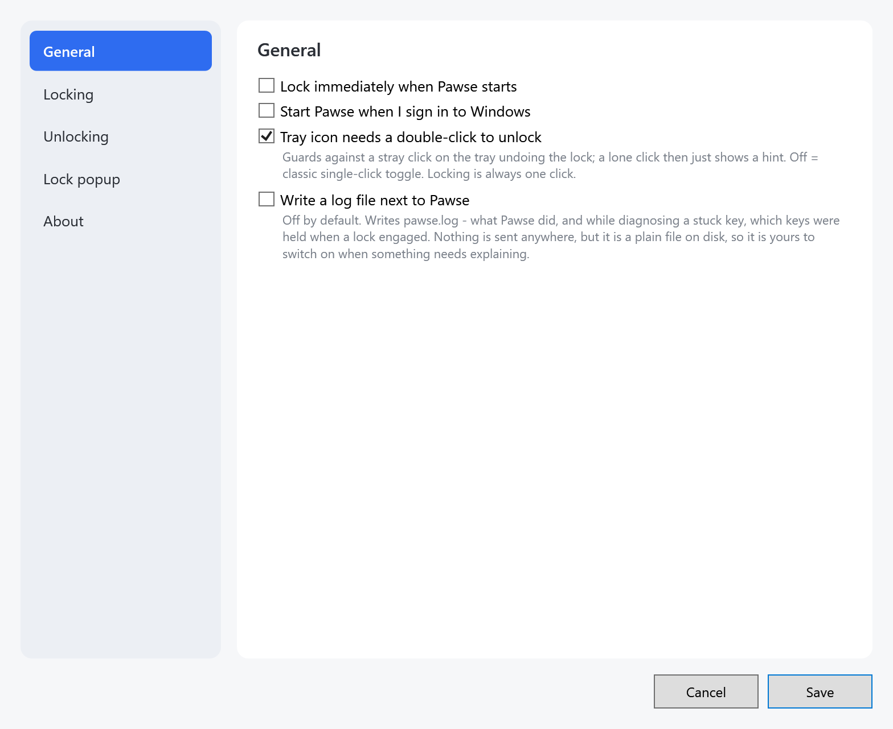

| Setting | Default | What it does |
| --- | --- | --- |
| **Lock immediately when Pawse starts** | off | Locks as soon as Pawse is running. |
| **Start Pawse when I sign in to Windows** | off | Adds Pawse to your sign-in programs. Installed copies only; a portable copy shows it greyed out. |
| **Tray icon needs a double-click to unlock** | on | While locked, a single click on the paw only shows a hint. Off: a single click toggles both ways. Locking is always one click. |
| **Write a log file next to Pawse** | off | Writes `pawse.log` (see [Where settings and the log live](#where-settings-and-the-log-live)). Switch it on when something needs explaining. |

### Locking

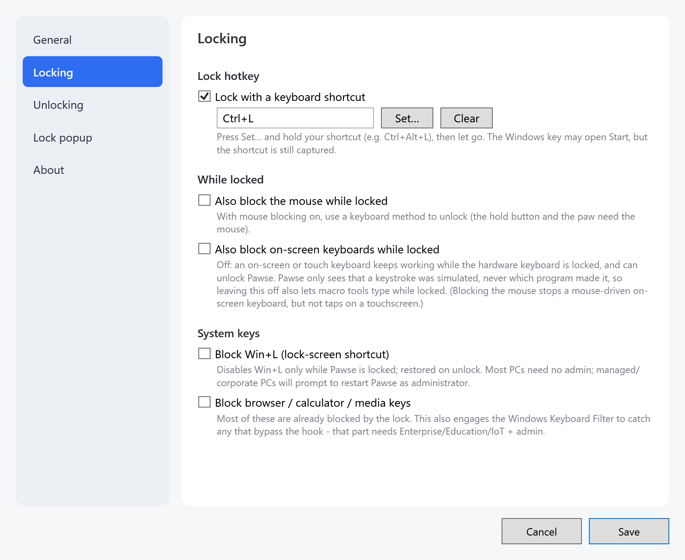

**Lock hotkey**
- **Lock with a keyboard shortcut** (on, `Ctrl+L`): **Set…** records a new shortcut
  (see [Recording a shortcut](#recording-a-shortcut)), **Clear** empties it.

**While locked**
- **Also block the mouse while locked** (off): clicks and movement are swallowed too. Unlock with
  the keyboard then; the hold button and the paw need the mouse.
- **Also block on-screen keyboards while locked** (off): when off, an on-screen or touch keyboard
  keeps typing and can unlock Pawse. Windows only tells Pawse that a keystroke was simulated, not
  which program sent it, so leaving this off also lets macro tools type while locked.

**System keys** (installed copies only; a portable copy shows them greyed out)
- **Block Win+L (lock-screen shortcut)** (off): disables `Win+L` only while Pawse is locked and
  restores it on unlock. Most PCs need no administrator rights. On a managed PC Pawse offers to
  **Restart as administrator** when you save or start; if your account isn't an administrator, it
  says the setting can't work there.
- **Block browser / calculator / media keys** (off): the lock already swallows most of these. This
  also engages the Windows Keyboard Filter for the few that bypass it, which needs Windows
  Enterprise, Education or IoT and Pawse running as administrator.

How these blocks work, and what stays out of reach: README,
[What it can and can't block](../README.md#what-it-can-and-cant-block).

### Unlocking

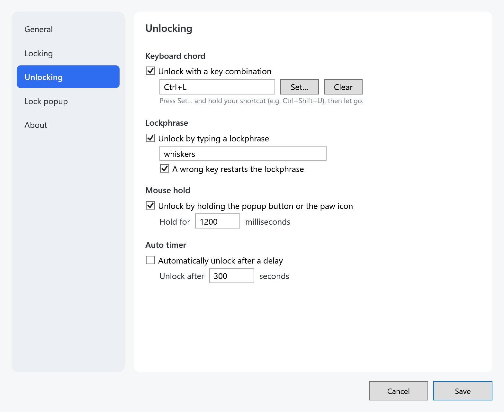

| Section | Setting | Default |
| --- | --- | --- |
| **Keyboard chord** | **Unlock with a key combination**, with **Set…** and **Clear** | on, `Ctrl+L` |
| **Lockphrase** | **Unlock by typing a lockphrase**, and the phrase in the box | off, `unlock` |
| | **A wrong key restarts the lockphrase** | on |
| **Mouse hold** | **Unlock by holding the popup button or the paw icon**, **Hold for** _n_ **milliseconds** | on, 1200 (100-10000) |
| **Auto timer** | **Automatically unlock after a delay**, **Unlock after** _n_ **seconds** | off, 300 (1-86400) |

The page warns you as you type:
- a lockphrase that is empty, or has characters other than letters, digits and spaces (it could
  never be typed while locked);
- a number outside its range (it is corrected when you save);
- a chord of modifiers only, such as `Ctrl+Shift`, which would fire the instant you hold them.

The two number boxes accept digits only. How each method behaves while locked:
[Unlocking the keyboard](#unlocking-the-keyboard).

### Lock popup

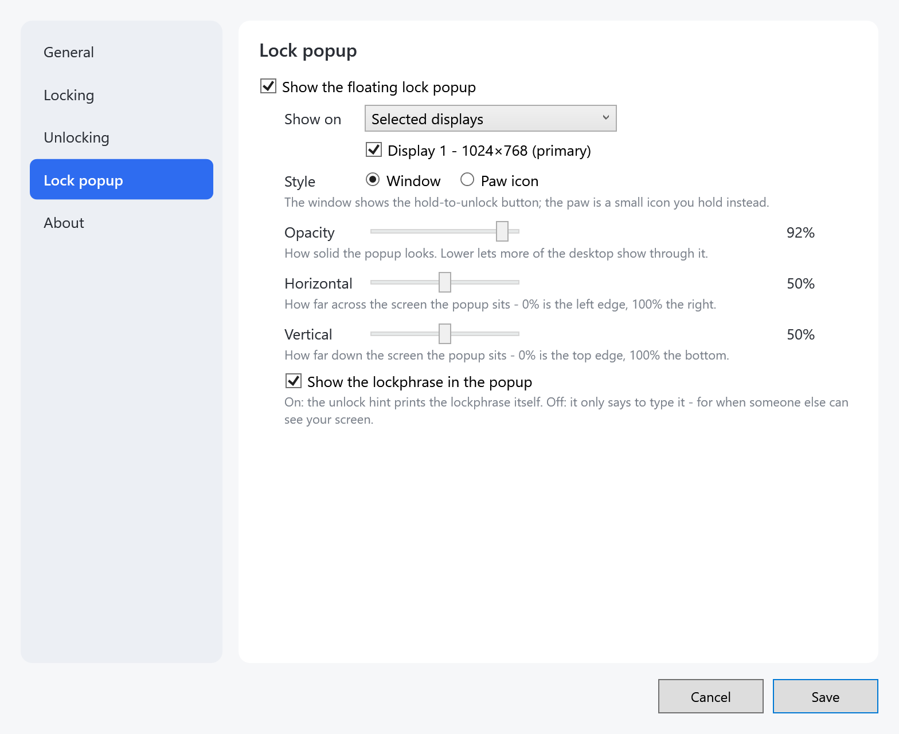

| Setting | Default | What it does |
| --- | --- | --- |
| **Show the floating lock popup** | on | Off: nothing is shown while locked, and mouse hold can't be used. |
| **Show on** | **Selected displays**, display 1 | **All displays**, or **Selected displays** with one box per connected display (**Display 1 - 1920×1080 (primary)** and so on). |
| **Style** | **Window** | **Window** (the card with the hold button) or **Paw icon**. |
| **Opacity** | 92% | 30% to 100%; lower lets more of the desktop show through. |
| **Horizontal** | 50% | 0% is the left edge, 100% the right. |
| **Vertical** | 50% | 0% is the top edge, 100% the bottom. |
| **Show the lockphrase in the popup** | on | Off: the hint says "type your lockphrase" instead of printing it, for when someone else can see your screen. |

With **Paw icon** picked, two more settings appear:

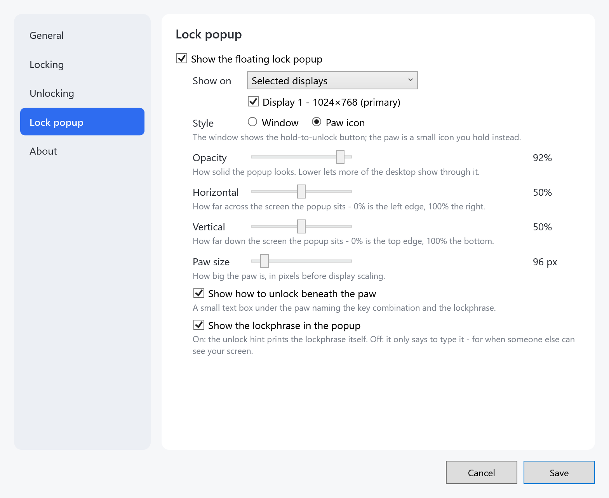

- **Paw size** (96 px): 32 to 512 pixels, before display scaling.
- **Show how to unlock beneath the paw** (on): the hint box under the paw.

When you save, two display choices are corrected, each with a message: no display ticked
switches the popup off, and every display ticked becomes **All displays**.

### About

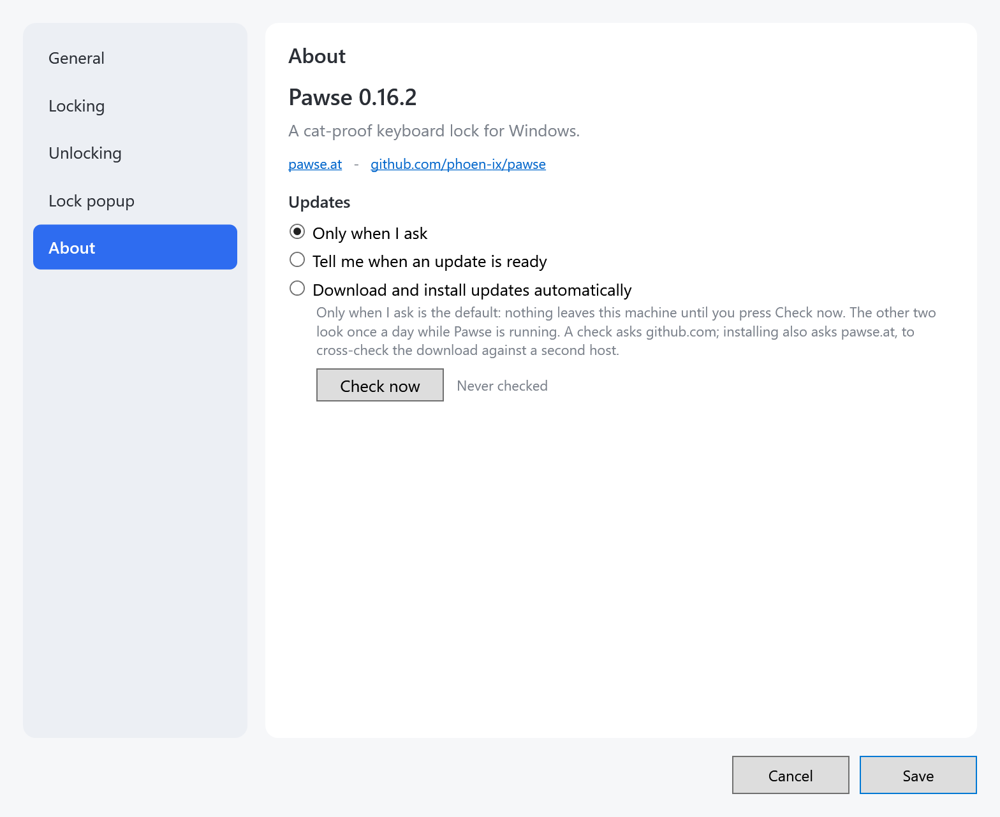

The version, links to pawse.at and the GitHub repository, and **Updates** (see
[Updating Pawse](#updating-pawse)). A portable copy also says so here. In the Microsoft Store
version this page only says **Updates come from the Microsoft Store.**

### Recording a shortcut

1. Click **Set…** next to the lock hotkey or the unlock chord (or click into the shortcut box).
2. Hold all the keys of the shortcut, for example `Ctrl+Shift+U`, then let go. The recorder
   takes what you held and closes.
3. Click **Save**.

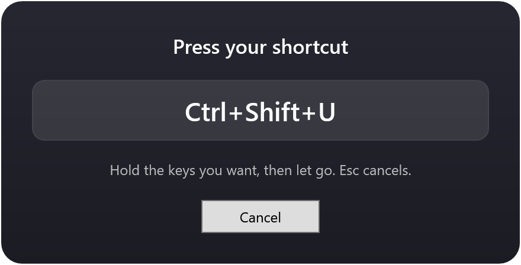

- **Esc** or **Cancel** keeps the old shortcut.
- Shortcuts use letters, digits, F-keys, Space, Tab, Enter or Backspace, with the modifiers. Any
  other key shows **That key can't be used** and the previous shortcut is kept.
- The Windows key may open Start while you record; the shortcut is still captured.

### Settings while locked

Settings can be opened while locked, but the keyboard is swallowed, so the text boxes can't take
input. A yellow banner says so; its **Unlock** button unlocks with the mouse. Checkboxes, sliders
and **Clear** still work; **Set…** answers **Unlock Pawse first to record a shortcut.**

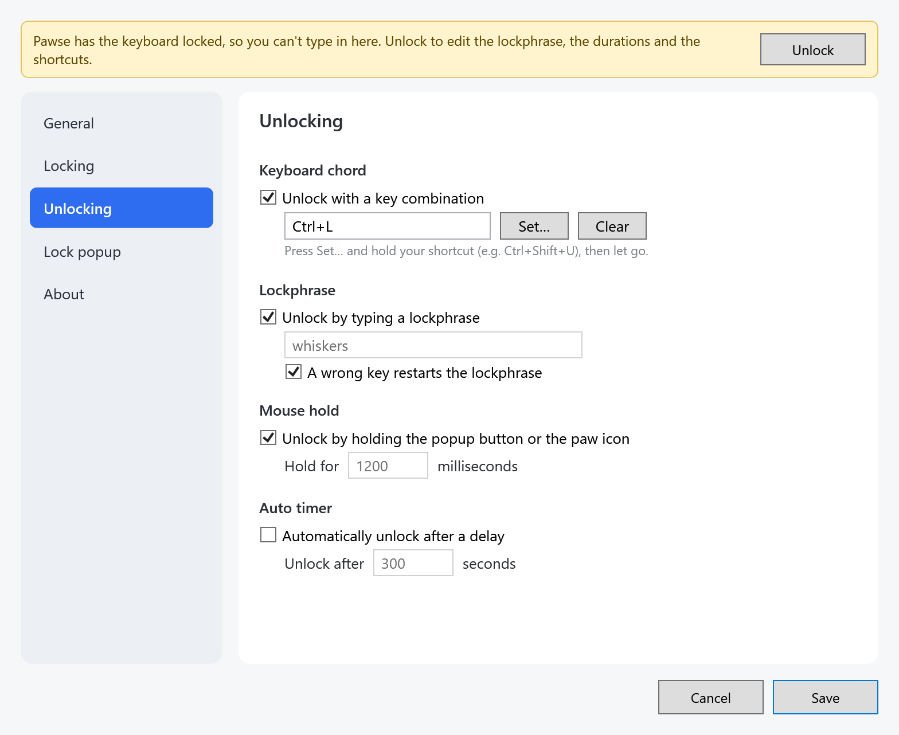

## Updating Pawse

Updates live in **Settings → About → Updates**. Nothing else in Pawse goes online; what a check
sends and to whom is in the README: [Privacy](../README.md#privacy).

| Level | What it does |
| --- | --- |
| **Only when I ask** (the default) | Nothing leaves the machine until you press **Check now**. |
| **Tell me when an update is ready** | Checks once a day while Pawse runs and says so in a tray balloon. |
| **Download and install updates automatically** | Checks once a day and installs. |

**Checking by hand:**

1. Right-click the paw → **Settings…** → **About** → **Check now**. The status beside it reads
   **Checking…**, then for example **Pawse 0.16.5 is the latest version.**
2. When there is something newer, Pawse asks **Download and install it now?**
3. Click **Yes**. Pawse downloads the update, checks it against its published checksum, and
   only then installs it. An installed copy runs the matching installer; a portable copy
   replaces its own exe and restarts. If Pawse is locked, installing closes it and releases the
   keyboard; the question says so.

If the check can't reach anyone, the button turns into **Try again** and a **Downloads page**
button appears next to it.

**Automatic installs** don't happen when they would surprise you. Pawse then shows the balloon
**Pawse &lt;version&gt; is available. Settings → About to install it.** instead, and you install
it with **Check now**. That happens when:
- Pawse was installed for everyone on the PC (installing needs administrator rights), or can't
  write to its own folder. The About page says so under the levels.
- Pawse is running as administrator.
- Its checksum can't be cross-checked against pawse.at, or the release has paused automatic
  installs.
- The same version was already tried and didn't take.

An automatic install that comes up while the keyboard is locked waits until you unlock.

### Updating from an older version

- **Portable copies on v0.8.0 through v0.11.0** refuse their own self-update ("reports
  version X.Y.Z.0, not X.Y.Z" - a version-comparison bug fixed in v0.11.1).
  - Update them once by hand: download the new zip, quit Pawse, replace the exe.
  - From v0.11.1 on, **Check now** takes it from there. Installed copies were never affected.
- **Minimal copies updating from v0.11.1 or earlier**: the minimal build now needs the
  **.NET 10** Desktop Runtime instead of .NET 8.
  - Install it first (`winget install Microsoft.DotNet.DesktopRuntime.10`, or from the
    [download page](https://dotnet.microsoft.com/download/dotnet/10.0)), then update.
  - An installed minimal copy declines the automatic update until the runtime is there and
    tells you so.
  - A **portable** minimal copy cannot check, and on **Download and install updates
    automatically** it will not wait to be asked - so install the runtime now, or switch to the
    full build, which needs nothing.
  - If one has already replaced itself and won't start, nothing is lost: the previous exe is
    still beside it as `Pawse.exe.old`. Install the runtime, or rename that file back over
    `Pawse.exe`.
  - Full and portable-full copies are unaffected and update as usual.

## Where settings and the log live

Right-click the paw → **Open config file** opens the settings file wherever it is. The folder
depends on how Pawse got onto the PC:

- **Portable** - next to `Pawse.exe`, always. A portable copy in a folder it can't write to
  (Program Files, a read-only drive) runs with settings it can't save, and says so.
- **Installed** - next to `Pawse.exe` as well, or in `%APPDATA%\Pawse` when that folder isn't
  writable, which is the case for an install for everyone in Program Files.
- **Microsoft Store** - the app's own data folder, which Windows removes with it.

Uninstalling removes them in every case.

- `pawse.json` - the settings. Edit them in the Settings window or by hand.
  - Quit Pawse before editing by hand, then start it again: Pawse reads the file at start, and
    **Save** in Settings writes the settings it has loaded over the file.
  - Comments and trailing commas are fine. A file Pawse can't read is kept as
    `pawse.json.bad` and Pawse starts from the defaults.
  - Starting with Windows is the one setting not in here: the Run entry in the registry is the
    setting, and Settings reads it from there (installed copies only - a portable copy writes
    nothing to the registry).
- `pawse.log` - a plain, timestamped log of what Pawse did. **Off by default**; switch on
  **Write a log file next to Pawse** in [Settings → General](#general) when something needs
  explaining.
  - It never leaves the machine, but it is a plain file on disk, and while diagnosing a stuck
    key it records which keys were held when a lock engaged - so it is opt-in rather than
    something to discover later. Your lockphrase is never written to it.

## Uninstalling Pawse

- **Installed:** Windows **Settings** → **Apps** → **Installed apps** → **Pawse** →
  **Uninstall**.
  - If Pawse is running, the uninstaller asks before closing it. **Yes** lets it shut down
    cleanly and hand back the keyboard.
  - An install for everyone asks for administrator rights.
  - Pawse's settings, log, registry entries and temporary files go with it; for an install for
    everyone, for every account on the PC.
- **Portable:** right-click the paw → **Quit**, then delete the folder.
- **Microsoft Store:** uninstall it like any other Store app; Windows removes its data.

## Troubleshooting

**The unlock chord does nothing.**
Hold only the chord's keys. If you locked with the same chord, let go of every key first, then
press it again. Make sure **Unlock with a key combination** is on and the popup names the chord.

**The lockphrase never unlocks.**
Only letters, digits and spaces can be typed while locked; Settings warns about any other
character. Without **A wrong key restarts the lockphrase**, stray keys don't reset you, so just
type the phrase again.

**The hold button or the paw doesn't unlock.**
Mouse hold is off, or **Also block the mouse while locked** is on. Use a keyboard method or the
tray paw.

**Some keys get through while locked.**
- A balloon **Pawse could not refresh its keyboard hook…** means Windows dropped the hook: unlock
  and lock again, or restart Pawse.
- Windows that run as administrator still receive keys unless Pawse runs elevated too
  (**Restart as administrator**).
- On-screen keyboards and macro tools type unless **Also block on-screen keyboards while locked**
  is on.

**Locking does nothing at all.**
After **Could not install the keyboard hook, so locking is disabled…**, restart Pawse.

**The lock hotkey doesn't lock.**
It is paused while the Settings window is open. Close or minimize Settings.

**I can't type in Settings.**
The keyboard is locked; click **Unlock** in the yellow banner.

**Win+L stays disabled, or the media keys stay dead.**
An earlier Pawse left its block behind (it was killed while locked, or ran as administrator) and
this one isn't allowed to undo it. Pawse says so in a balloon; use **Restart as administrator**
from the tray menu once, and the block is undone.

**The lock popup doesn't show.**
Check **Show the floating lock popup**. A display that is no longer connected sends the popup
to the primary display.

**"Your saved config had no working unlock method…"**
Every unlock method in `pawse.json` was off or unusable, so Pawse turned the keyboard chord on;
the balloon names it.

**"Your settings could not be saved…"**
Pawse's folder isn't writable. The settings apply until you quit. For a portable copy, move it to
a folder you can write to.

**A downloaded exe won't start.**
Unblock it (right-click → **Properties** → **Unblock**). The minimal build also needs the
.NET 10 Desktop Runtime (x64).

**Still stuck?**
Switch on **Write a log file next to Pawse**, reproduce the problem, and look at `pawse.log`.
Issues go to [GitHub](https://github.com/phoen-ix/pawse/issues).
