# Screenshots

Every window Pawse has, and the website. Made by the docs tour - see
[Regenerating](#regenerating) - from a fixture config: the defaults plus the lockphrase
`whiskers`. The app shots show a window's contents without the Windows title bar.

## Lock popup - window style

Shown while locked, on the displays you pick. It names every unlock method that works in the
current settings; hold the button to unlock with the mouse.

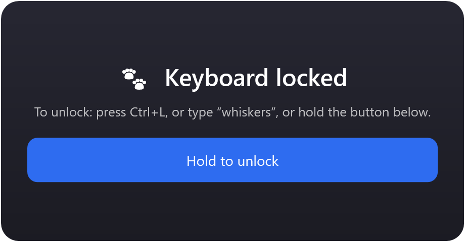

## Lock popup - paw icon style

The same popup as the tray paw, at any size, with an optional hint box beneath. Hold the paw
to unlock: it fills green from the bottom.

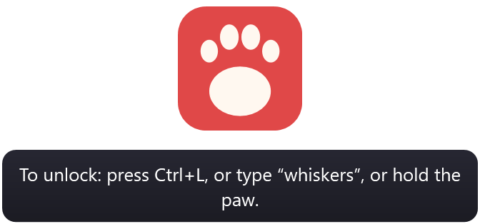

## Tray menu

Right-click the paw in the system tray. "Restart as administrator" is added when Pawse isn't
already elevated. (This one is drawn by WinForms at the screen's own scale, so it is 1x.)

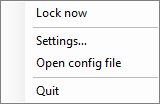

## Settings - General

Lock on start, start with Windows, the tray double-click guard and the opt-in log file.

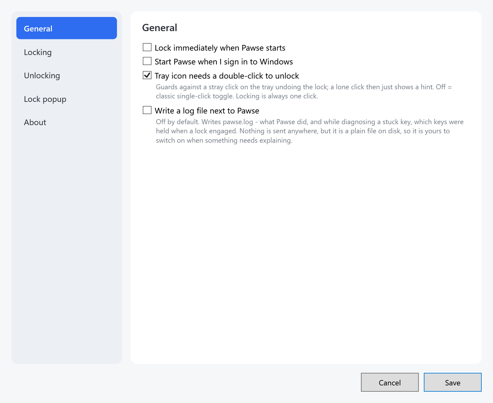

## Settings - Locking

The lock hotkey, what else to block while locked (mouse, on-screen keyboards), and the system
keys: Win+L and the browser / calculator / media keys.

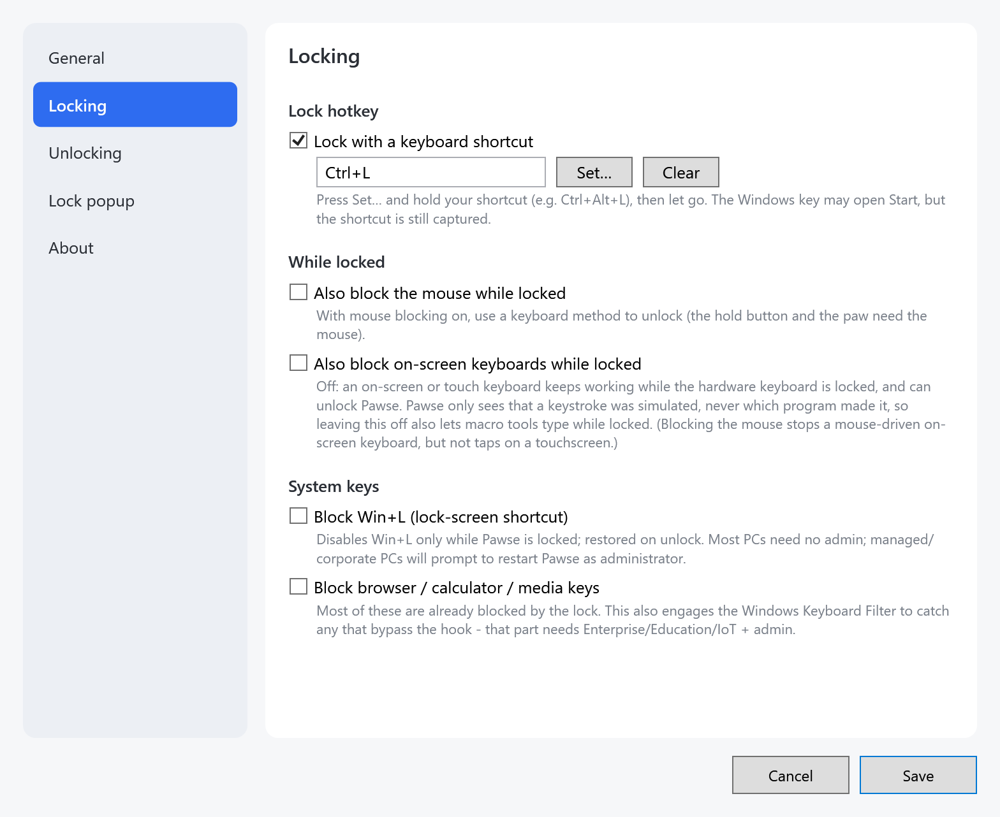

## Settings - Unlocking

The four unlock methods, each switched on or off on its own: a key combination, a lockphrase,
holding the popup button or paw, and an automatic timer.

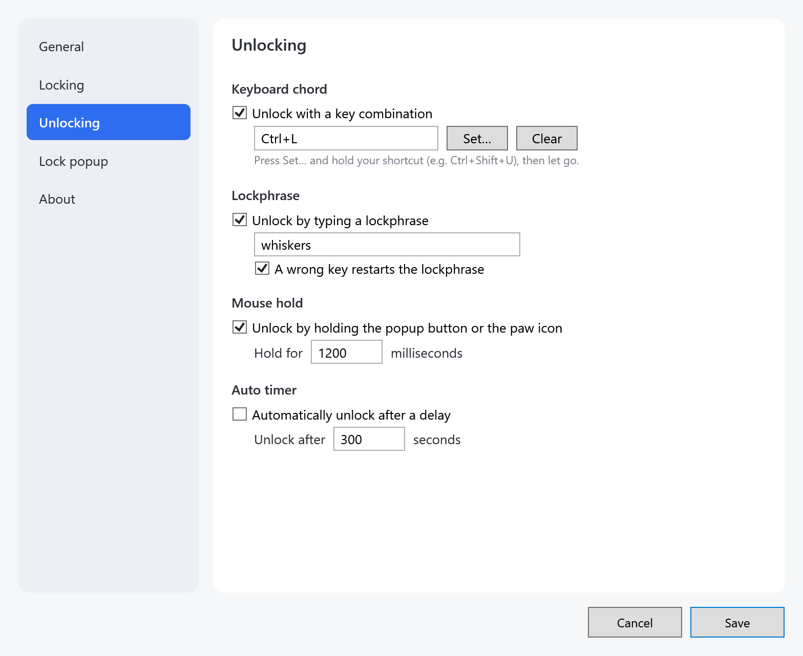

## Settings - Lock popup

Whether the popup shows and where: all displays or selected ones, its style, opacity and
position.

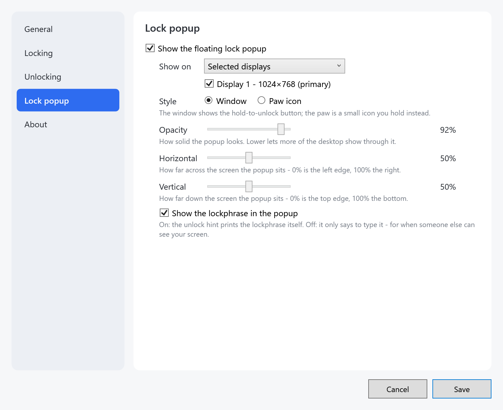

With **Paw icon** picked, the paw's size and its hint box appear.

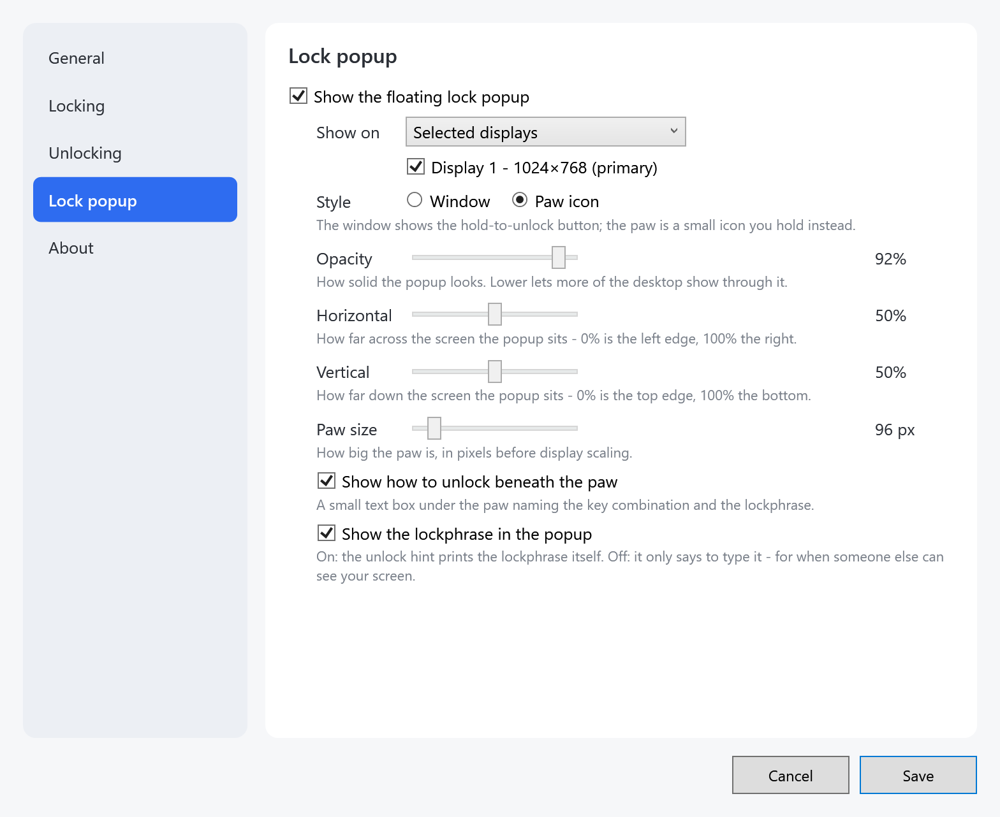

## Settings - About

The version, links, and how far Pawse may go about updates on its own. **Only when I ask** is
the default; **Check now** is the only thing that goes online.

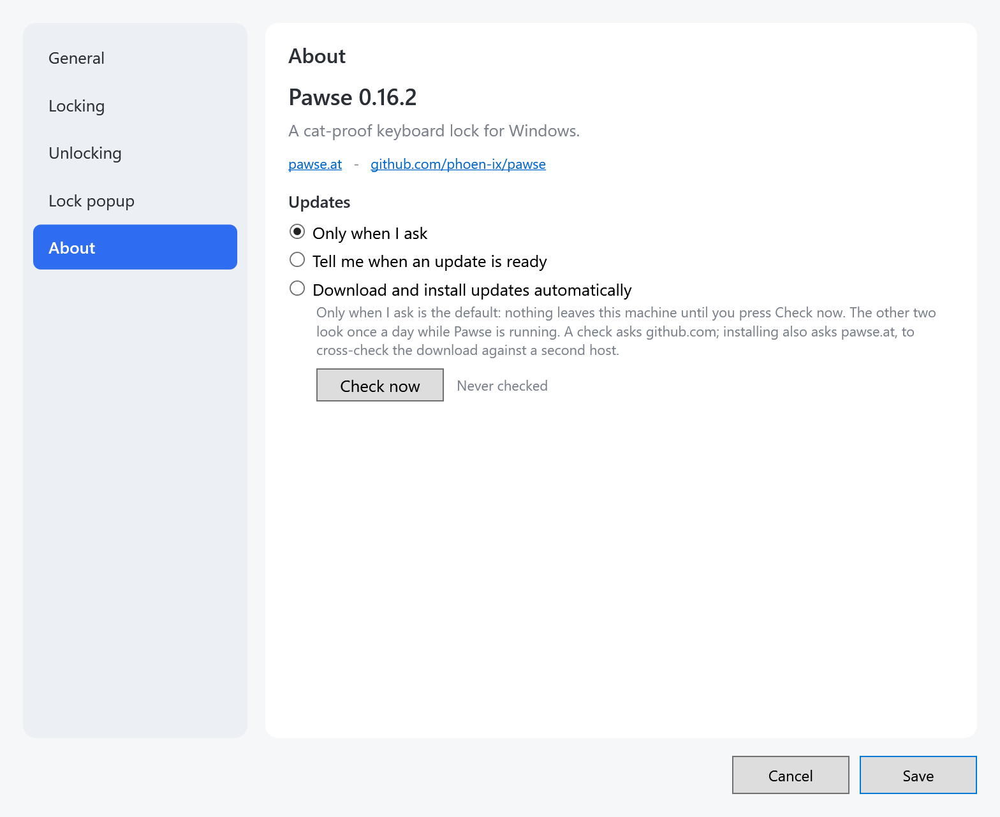

## Settings while locked

Opened while Pawse has the keyboard locked: a banner says why the text fields are disabled,
and its **Unlock** button is the way out with the mouse.

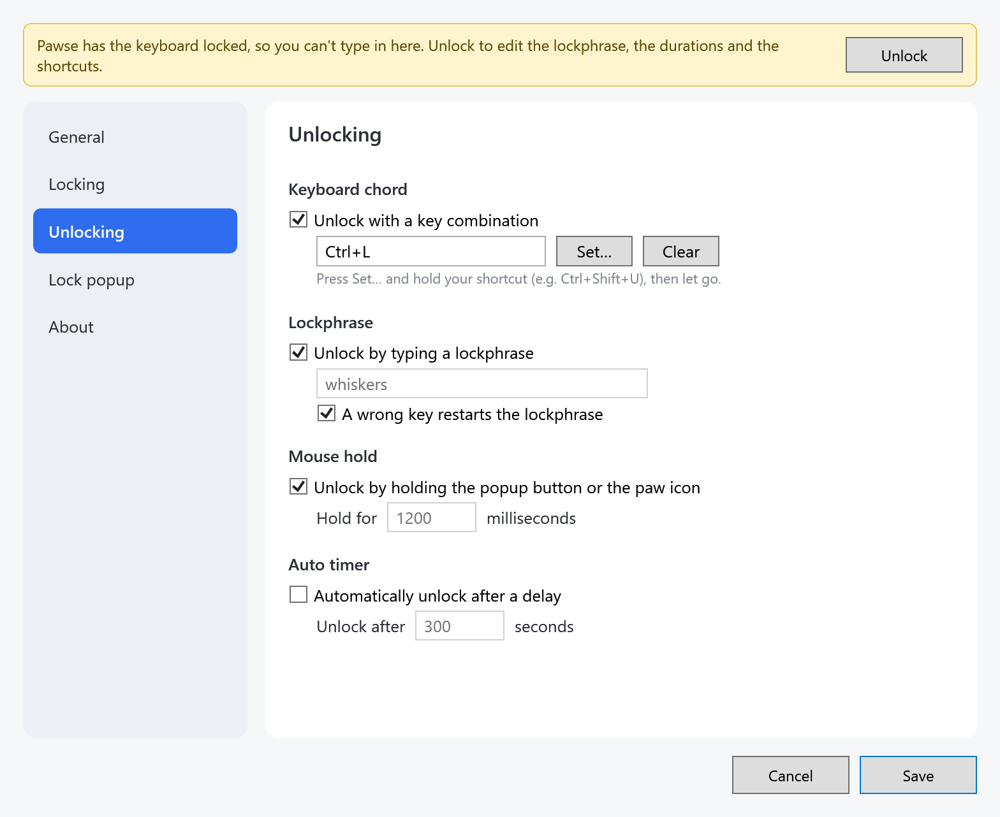

## Settings in a portable copy

A portable copy writes nothing to the registry, so starting with Windows is greyed out, with
the reason beside it. The Locking page does the same for Block Win+L and the media-key block.

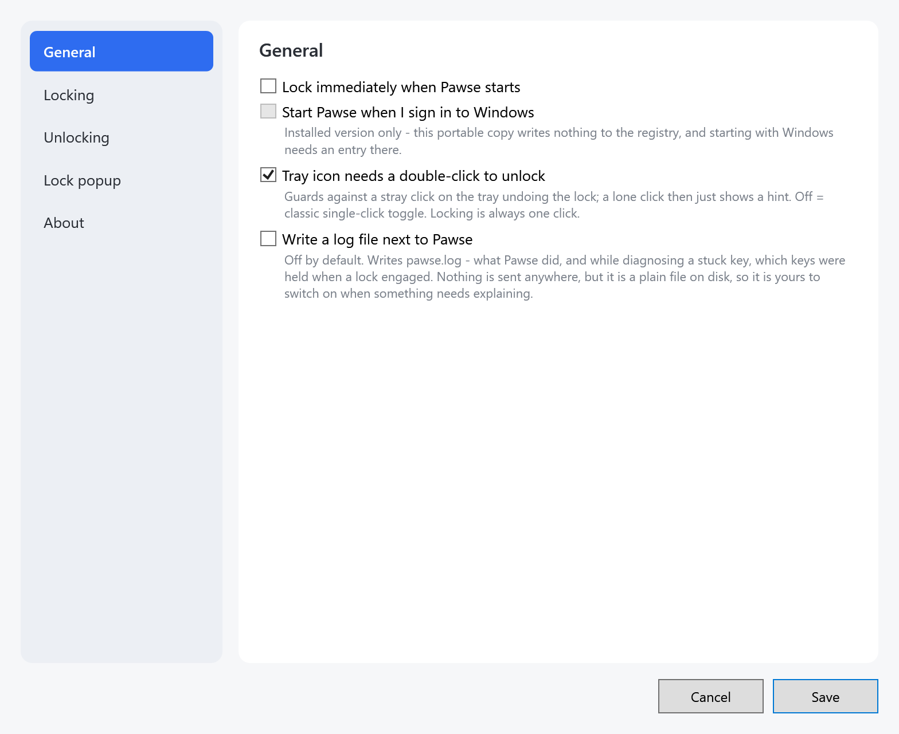

## Recording a shortcut

**Set…** next to a shortcut opens the recorder: hold the keys, let go, and it takes what you
held. Esc cancels.

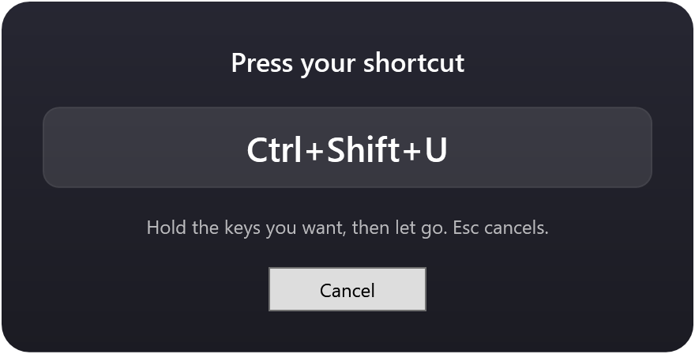

## Website - pawse.at

The home page's first screen ([`web/site/index.html`](../../web/site/index.html)), cropped to
the hero column.

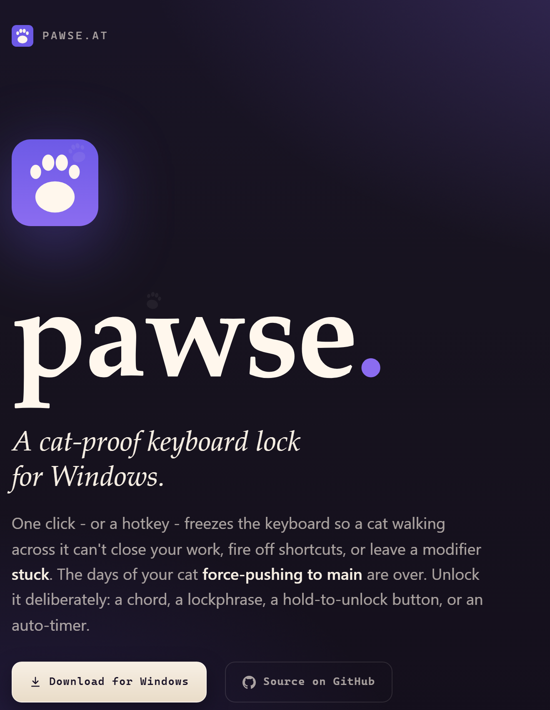

On a phone:

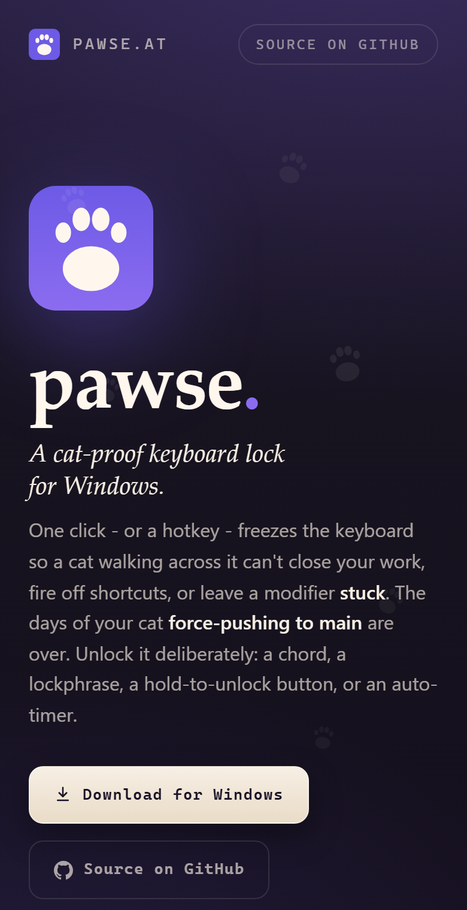

The privacy page ([`web/site/privacy.html`](../../web/site/privacy.html)).

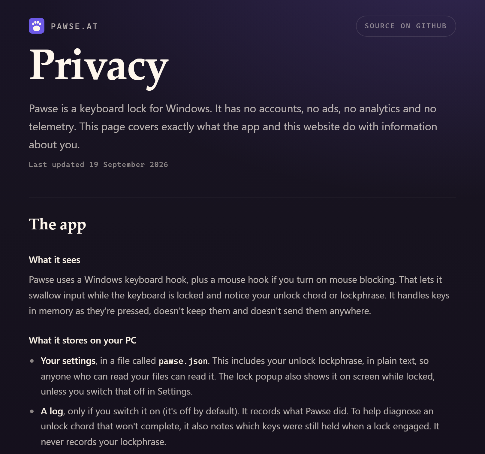

## Regenerating

`scripts/docs-screenshots.sh [outdir]` (default: this folder) runs both halves of the tour:

- **Website** (`site-*.png`): serves `web/site` on `127.0.0.1:$((PORT_BASE+2))` (PORT_BASE
  default 25950) and runs the Playwright tour in [`e2e/docs/`](../../e2e/docs/). Needs Python,
  and Node with `npm ci && npx playwright install chromium` in `e2e/`.
- **App** (`app-*.png`), Windows only:
  [`DocsScreenshotTests`](../../tests/Pawse.Tests/DocsScreenshotTests.cs), an xunit test that
  opens each window on an STA thread and renders it at 2x. It only runs when
  `DOCS_SCREENSHOT_DIR` is set, so a plain `dotnet test` skips it.

The committed set comes from the **docs-screenshots** workflow (Actions → docs-screenshots →
Run workflow, on `windows-latest`): download its `docs-screenshots` artifact, unzip it here,
optimise with `oxipng -o 4 --strip safe *.png`, check the diff, commit. `ci.yml` runs both
halves on every push as a render check and throws the PNGs away.
